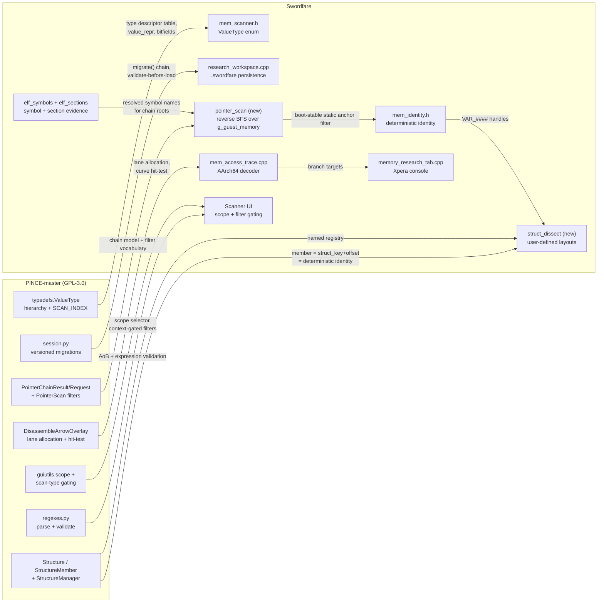

# PINCE Integration & Salvage Report

**Target:** `PINCE-master/` (GPL-3.0, 26 868 lines across 129 Python files, PyQt6)
**Audience:** whoever builds the Swordfare live-memory console
**Verdict:** high value, but **not where you would expect it.** The parts worth taking are the
*data models and the UX semantics*, not the memory engine. Read §1 before planning anything.

---

## 0. First, a correction that changes the plan

Two assumptions worth settling before this report is actionable:

1. **PINCE is not an Android tool.** It is a Linux/X11 native-game memory editor — the spiritual
   Cheat Engine port for Linux. Its engine is `ptrace` + an embedded **GDB** doing the reads,
   writes, breakpoints and disassembly. There is no JNI, no ART, no Android anything in it.
2. **Its scan engine is not in this checkout.** `.gitmodules` lists `libmemscan` as a submodule
   (`https://github.com/brkzlr/libmemscan`) and `libmemscan/` is **empty**. Every algorithm-level
   call in PINCE goes through it:

   ```python
   from libpince.libmemscan.memscan import ScanLevel, Libmemscan, PointerScanOptions
   ```

So the single most valuable artifact — a vectorised multi-threaded scanner with scan *scopes* —
is *absent*. What we have instead is something arguably more useful for us: **the complete
interface contract and UX semantics** of that engine, because the GUI has to drive it. That is
enough to know exactly what to build, and `libpince/typedefs.py` + `GUI/Utils/guiutils.py`
document it precisely.

**Why this still matters to Swordfare despite the platform mismatch:** we are an *emulator*. We
own `g_guest_memory` as one flat host buffer, so we need none of PINCE's cross-process machinery —
no `/proc/<pid>/maps`, no ptrace, no GDB IPC, no `filter_regions`. What we *cannot* get for free,
and what PINCE has figured out, is the **model layer**: value types, scan scopes, structure
dissect, pointer-chain semantics, session versioning. That is platform-agnostic and is where our
console is thinnest.

---

## 1. What is actually present, and what it is worth

| Area | Files | LOC | Verdict |
|---|---|---|---|
| Value type system | `libpince/typedefs.py` | 797 | **Steal the design.** Best-in-class. |
| Scan scope + filter gating | `GUI/Utils/guiutils.py` (`fill_scope_combobox`, `fill_scan_type_combobox`) | 481 | **Steal the semantics.** |
| Structure dissect | `libpince/typedefs.py` (`Structure`, `StructureMember`) + `GUI/Widgets/MonoDissect/` | 480 | **Steal the data model.** |
| Pointer chains | `typedefs.PointerChainResult/Request`, `GUI/Widgets/PointerScan*/` | ~800 | **Steal the model**, engine absent |
| Disassembly arrows | `GUI/Overlays/DisassembleArrowOverlay.py` | 414 | **Steal the algorithm.** Genuinely good. |
| Session persistence | `GUI/Session/session.py` | 537 | **Steal the versioning.** We have none. |
| Region / ELF plumbing | `libpince/utils.py` | 1257 | Compare only; we do this differently. |
| Hex / address models | `GUI/AbstractTableModels/HexModel.py`, `AsciiModel.py` | 149 | Read for model/view ideas. |
| Parse/validate regexes | `libpince/regexes.py` | 109 | **Copy verbatim-ish.** |
| Debugger memory view | `GUI/Widgets/MemoryView/MemoryView.py` | 1834 | Feature list to mine, not code. |
| Script engine | `GUI/Widgets/LibpinceEngine/` | ~900 | Skip — our Lua surface is adequate. |
| Mono/.NET dissect | `libpince/monocore.py`, `GUI/Widgets/MonoDissect/` | ~1000 | **Skip** — Swordigo is native C++. |
| Speedhack | `libpince/speedhack.py` | 1381 | **Skip** — ours is better (§6). |
| Debugger core | `libpince/debugcore.py` | 3436 | **Skip** — ptrace/GDB, no analogue. |
| Themes / i18n | `GUI/Settings/themes.py`, `tr/`, `i18n/` | — | Skip — QPalette/Qt `.ts`. |

---

## 2. The five things worth taking (ranked by value)

### 2.1 Scan *scope* — the input-side fix for a flooded scan

**Source:** `GUI/Utils/guiutils.py:198` + `typedefs.ScanLevel` (from `libmemscan`)

```python
# PINCE offers exactly four scopes, named for what they include:
ScanLevel.HEAP_STACK_EXE       # "Basic"
ScanLevel.HEAP_STACK_EXE_BSS   # "Normal"   <- default
ScanLevel.ALL_RW               # "Read/Write"
ScanLevel.ALL                  # "Full"
```

**Why this is the highest-value item.** We just measured this problem from the other end: a
module-scoped exact scan for a common 4-byte value returned 12 hits and **8 were inside `.dynsym`
and `.rela.plt`** — the image's own bookkeeping. I patched the *output* side (`skip ELF tables`,
`elf_sections.h`). PINCE fixes it on the *input* side, and their ordering of the problem is
better: the default scope is deliberately **not** `ALL`, because scanning everything is what
produces garbage. Ours currently defaults to "module range only", which is the *worst* choice for
this image, since the module's lowest region is the symbol table.

**Concrete take:** replace our single `module range only` checkbox with a scope selector whose
default excludes metadata and non-image regions:

```
scope:  image code + data          <- recommended default
        writable image data only   (.data/.bss/.got)
        everything registered
        whole guest address space
```

And keep `skip ELF tables` as a separate, orthogonal refinement of the first two.

**Second concrete take — gate the filter list by context** (`guiutils.py:264`). PINCE rebuilds the
scan-type dropdown from `(scan_mode, value_type)`, because most combinations are meaningless:

* **new** scan, numeric → `Exact, Not, Less, More, Between, Unknown`
* **new** scan, string/AoB → `Exact, Unknown`
* **ongoing** scan, numeric → adds `Increased, IncreasedBy, Decreased, DecreasedBy, Changed, Unchanged`
* **ongoing** scan, string/AoB → `Exact` only

We currently show all 12 always, so a researcher can pick "Increased" on a first scan and get a
silent no-op (`scan_seeds()` falls back to `UnknownInitial`). Offering only valid filters is both
kinder and more honest.

### 2.2 The polymorphic value type system

**Source:** `libpince/typedefs.py:256-660`

This is the cleanest part of the codebase and the thing our `ValueType` flat enum most obviously
lags. The interface every concrete type implements:

```python
class ValueType:                      # abstract; cannot be instantiated
    read_size -> int | None           # bytes to read; None for struct/aggregate
    parse(text)   -> Any | None       # researcher typed this
    decode(bytes) -> Any
    encode(value) -> bytes | None
    text()        -> str              # for the table column
    value_repr                        # UNSIGNED | SIGNED | HEX
    endian                            # HOST | LITTLE | BIG
    serialize() / deserialize(...)    # stable numeric IDs for the session file
```

with concrete families: `IntegerValueType(8/16/32/64)`, `FloatValueType(32/64)`,
`StringValueType(ascii/utf-8/utf-16/utf-32)`, `ByteArrayValueType`, `BitFieldValueType`
(register-style bit slicing), `StructValueType`.

**What to take:**

* The **`value_repr` axis** (unsigned / signed / hex) as a *display* property independent of the
  storage type. We have a single global `hex` checkbox that changes parsing *and* formatting
  together; PINCE separates "how is this stored" from "how is this shown". That is the right
  split, and it is a small change to `MemScanner::format_value`.
* **`endian`** as a per-row property. Irrelevant for our little-endian guest, but it is what makes
  `_endian_suffix()`/`_repr_suffix()` produce type labels like `Int32(h)<L>`. Worth noting only
  because the *labelling* scheme is good: a column can state the type unambiguously in ~10 chars.
* **`BitFieldValueType(bits, start_bit)`** — we have nothing like this, and Swordigo is a 2013
  mobile game full of packed flags. A one-byte "flags" field is currently opaque to us; PINCE lets
  a researcher define `Int8` bits 2..4 as a field. That is a real reverse-engineering capability,
  not a convenience.
* **Serialization with frozen numeric IDs** (`typedefs.py:640`): `_SERIALIZED_TYPE_IDS` is
  explicitly commented *"NEVER renumber these entries while old tables are supported."* That is the
  hard-won lesson that a persisted type must have a stable wire ID. Our `ResearchWorkspace`
  currently serialises type by **name string**, which survives renames but not a rename *and*
  a version skew. Worth revisiting (§2.5).

**Where it lands:** `src/game/research/mem_scanner.h` `ValueType` — either promote to a small
class hierarchy (as PINCE does) or keep the enum and add a per-type descriptor table carrying
`{read_size, parse, decode, encode, text, default_repr}`. I would do the latter: it gets all the
benefit for a fraction of the churn, and the functions already exist as free functions so they
become table entries.

### 2.3 Structure dissect as a first-class, user-defined artifact

**Source:** `libpince/typedefs.py:664-712` (`StructureMember`, `Structure`), `GUI/Session/session.py:485` (`StructureManager`)

```python
StructureMember(name, offset, value_type=None, struct_ref=None, is_pointer=False)
# exactly one of value_type / struct_ref is set
# struct_ref + is_pointer  -> pointer member (follow it)
# struct_ref, no is_pointer -> inline/embedded member (offset into this struct)
```

**Why this matters a lot for us.** We decode structs **only** from the recovery catalog. A
researcher cannot write down a structure they are *in the middle of* discovering. PINCE models
that directly, including nested and pointer members, and `StructureManager` keeps a **named
registry** so structures can refer to each other by name and be reused across rows and sessions.

**Concrete take:** this is the natural home for our `VAR_####` work. A user-defined `Structure`
whose members are `StructureMember("field_0x18", 0x18, IntegerValueType(32))` gives an unnamed
field a *place in a layout*, and combined with `mem_identity.h` a member's identity becomes
`(struct_key, offset)` — deterministic, which is exactly the property we already promise. Right
now a `VAR_####` from a scan is a floating address; as a structure member it has a parent.

**Where it lands:** new `src/game/research/struct_dissect.{h,cpp}`, rendered by the existing
`StructDecoder` machinery, persisted by `ResearchWorkspace`. Reuse the catalog's
`CatalogStruct`/`CatalogField` shapes so the UI can render recovered and user-defined layouts with
the same code path — that reuse is the whole reason this is cheap.

### 2.4 Pointer chains: the model, and the scanner we still need

**Source:** `typedefs.py:713-752` (`PointerChainResult`, `PointerChainRequest`), `GUI/Widgets/PointerScan/PointerScan.py`, `PointerScanFilter/`, `PointerScanSearch/Form/PointerScanSearchDialog.py`

`PointerChainResult` carries `base_address + offsets + final_address + module_name`; a
`PointerChainRequest` is the *query*; `PointerScanFilter` narrows a stored pointer map (by module,
by offset bounds, by depth, by whether the chain transits a writable region); `PointerScanSearch`
searches a mapping **backwards** from a target address to find chains that reach it. The windows
are thin because the heavy lifting is in the absent `libmemscan` — but the *filter vocabulary* is
fully visible in `PointerScanFilterDialog`, and that vocabulary is the design.

**Our gap:** `LiveObjectMap::PointerPath` resolves a chain we already know. We have **no pointer
scanner** — nothing that answers "what multi-level pointer, from where, reaches
`GameSceneController+0x78`?" That is a headline feature in CE/GG and the single best answer to
"the address changes every boot".

**Why we can do it better than PINCE:** our address space is one host buffer and we already have
`ModuleMap` (RVA↔VA) and `elf_sections` (which regions are writable). A pointer scan over
3.5 GB of flat memory is a straightforward reverse BFS, and the "static anchor" requirement — the
thing that makes a pointer path *boot-stable* — is a filter we can apply exactly (does the chain
bottom out in a module RVA, or in heap?). PINCE cannot express that distinction as cleanly as we
can, because our identity layer already knows what a static anchor is.

### 2.5 Versioned persistence with explicit migrations

**Source:** `GUI/Session/session.py:31-160`

```python
def _legacy_to_v1(content): ...
def _v1_to_v2(content): ...
def _v2_to_v3(content): ...
def migrate_version(content) -> dict
def is_valid_session_data(content) -> bool
```

Every format change gets a migration function, and loading validates before use. The chain is
applied in order, so a table saved three versions ago still opens.

**Our gap:** `research_workspace.cpp` writes JSON with a `version` field and **no migration path
and no validation**. That is a research-integrity bug, not a nicety: the entire promise of
`mem_identity.h` is that a researcher's names and provenance survive a crash, a restart and an
app update. A schema change currently orphans every `.swordfare/` store in the wild.

**Concrete take:** copy the *shape* — `migrate(json) -> json` with a step per version, run before
any field is read, plus a `is_valid_something()` predicate so a corrupt store is reported rather
than half-loaded. Small job, and it protects the one promise the feature exists to make.

---

## 3. The disassembly arrow overlay — the "cool, not slop" feature

**Source:** `GUI/Overlays/DisassembleArrowOverlay.py` (414 lines, and it earns them)

This draws jump/call arrows down the left gutter of a disassembly listing, and it solves the
problems that make such a thing look amateur:

```
_assign_lanes(resolved)          # multiple arrows share the gutter: assign each a lane so
    lane_is_free(top, bottom)    #   no two overlap; a lane is reused as soon as it is free
    lowest_free(top, bottom)
_arrow_points(y0, y1, src_dir, tgt_dir, lane_x, anchor_x)   # direction-aware curve geometry
_arrow_at(x, y)                  # hover hit-testing to identify the arrow under the cursor
_arrow_color(key), _palette_key(source, target)             # stable colour per (source,target)
_draw_arrow(..., dim=, highlight=)                          # dim unrelated arrows, highlight the
                                                            #   ones for the selected instruction
```

The lane allocator, the direction-aware geometry, and the hit-testing are **language-agnostic
algorithm three**. The hover-identify-a-curve test is the part most implementations skip, and it
is what makes arrows feel like a real tool rather than decoration.

**Where it lands:** we have an AArch64 decoder (`mem_access_trace.cpp`) that already extracts
branch targets for the access-trace work, and `Instruction Evidence` is a table. Add a lane
allocator + `ImDrawList` polylines. Concretely:

1. Extend the decoder to report `B`/`BL`/`CBZ`/`TBZ` immediates and their resolved target RVAs.
2. `assign_lanes()` over [source_row, target_row] — reuse the exact algorithm.
3. `ImDrawList::AddBezierCubic` per arrow, one colour keyed on `(src, tgt)`.
4. Hover: `ImGui::IsMouseHoveringRect` per arrow's control-point bounding box, then a real
   distance-to-cubic test for the final decision.

**Why it is worth the effort:** it converts a flat instruction list into a *control-flow picture*,
which is the difference between "auditing instructions" and "reading code". It is also the single
most visible signal that this is a professional tool rather than a table of numbers.

---

## 4. Smaller, cheaper steals

| What | Source | Take |
|---|---|---|
| Input parsing/validation regexes | `libpince/regexes.py` | `bytearray_input = ^[A-Fa-f0-9?]{2}(\s+[A-Fa-f0-9?]{2})*$` — AoB with `?` wildcards and *anchored* validation. Our AoB parser accepts malformed patterns and fails later. Also `expression_with_hex`, `hex_arithmetic`. |
| Address-box expressions | `libpince/regexes.py:hex_arithmetic` + `GUI/Widgets/ManualAddress/ManualAddress.py` | PINCE's address field takes arithmetic, not a literal. Our `parse_address` takes hex only. Supporting `GameSceneController+0x78`-style *symbolic* input is the natural pairing with `elf_symbols`, and it is what our own columns now print. |
| Bitfield-aware value display | `typedefs.py:395` | see §2.2 |
| Tagged region model | `utils.py:222` `tuple_region_info(start, end, perms, file_name, region_index)` | We have `ModuleExtent`, but no per-region permission concept. Needed for a scope selector (§2.1) and for "is this address writable". |
| Model/view separation | `GUI/AbstractTableModels/`, `GUI/TableViews/` | PINCE keeps sort/filter state in a model object, not in the draw call. Our tables rebuild + re-filter per frame in `draw_address_list()`. A `AddressListModel` holding (filter, sort, visible-cache, generation) would cut per-frame work and make the table sortable — which we currently are not. |
| Sub-item delegate editing | `GUI/ItemDelegates/`, `Validators/` | Inline per-cell type-aware editing; we have a single text box. |
| Hex model design | `GUI/AbstractTableModels/HexModel.py` (118 lines) | Clean address↔(row,col) mapping; ours is inside the view. |
| Feature list to mine | `GUI/Widgets/MemoryView/MemoryView.py` | `edit_instruction`, `nop_instruction`, `step_over`, `execute_till_return`, `go_to_dialog`, stack view, register view, selection→address mapping, copy-as-{hex,string,bytes}. Useful as a checklist, not as code. |

---

## 5. Feature checklist mined from `MemoryView` (what a serious tool has that we don't)

Reading its 60-odd methods as a requirements list rather than as code:

- [ ] **Edit / NOP a single instruction** at the cursor (`edit_instruction`, `nop_instruction`) — we can write memory but have no patch-the-code primitive.
- [ ] **Go-to-address dialog** with expression support and history.
- [ ] **Selection → address mapping** (`hex_point_to_address`, `address_to_hex_point`) and multi-byte selection with a length readout. Ours maps neither way.
- [ ] **Copy selection as** hex / string / raw bytes.
- [ ] **Stack view** and **register view** as first-class panes.
- [ ] **Breakpoint / watchpoint toggling from the listing**, not only from a form.
- [ ] **Trace window** (`show_trace_window`) — we have `AccessTrace` data with no view for it.
- [ ] **Session file: open/save/unsaved-changes prompt** (`check_unsaved_changes`) — we autosave with no explicit save and no "you have unsaved changes" state.
- [ ] **Named entity registry** (`StructureManager._registry()`) so artifacts reference each other by name.

---

## 6. What to deliberately NOT take

| Area | Files | Why not |
|---|---|---|
| Debugger core | `libpince/debugcore.py` (3436) | GDB-driven ptrace. We own the CPU; there is no inferior process and no GDB. Nothing to port. |
| Process/environment plumbing | `utils.py` `get_regions`, `get_process_list`, `is_wine_process`, `get_module_load_bias` | `/proc`-based. We have `ModuleMap` + the ELF loader. Read for comparison, don't port. |
| Speedhack | `speedhack.py` (1381) | Hooks timing syscalls in a foreign process. We already scale the guest's virtual clock directly (`advance_guest_virtual_clock(dt * g_game_speed)`), which is strictly better — no syscall hooks, no signal races. |
| Mono / .NET layer | `monocore.py`, `GUI/Widgets/MonoDissect/`, `mono_collector/` | Swordigo is native C++ with protobuf. Zero applicability. |
| Scripting engine | `GUI/Widgets/LibpinceEngine/`, `ScriptEditor.py`, `MainWindow/LuaConsole` analogues | Our Lua surface (`lua_console`, script manager) already covers this, and PINCE's is bound to GDB's command language. |
| Theming | `GUI/Settings/themes.py`, `media/` (CC-BY) | QPalette dictionaries. We now have the Xpera toolkit; porting a Qt palette would be a step backwards. |
| i18n | `tr/`, `i18n/` | Qt `.ts` files. Different i18n stack. |
| Overlays other than arrows | `GUI/Overlays/` (rest) | Qt painter overlays tied to QTableView geometry. |

---

## 7. Integration map



---

## 8. Prioritized plan

Ordered by (value ÷ effort), with the reason it is in that position.

**P1 — Scan scope selector + context-gated filter list.**
Smallest change with the largest effect. Directly addresses the measured problem (8 of 12 hits
were ELF metadata) on the input side, and stops the UI offering filters that silently do nothing.
Touches `memory_research_tab.cpp` only.

**P2 — Session migrations + load validation.**
Tiny, and it protects the feature's core promise. `research_workspace.cpp`'s `version` field is
currently decorative.

**P3 — `value_repr` split + bitfield type.**
Decouples "stored as" from "displayed as" (small, improves every table) and adds a genuine RE
capability (packed flags, which this engine is full of).

**P4 — Structure dissect with a named registry.**
The missing home for semi-discovered layouts, and it gives every `VAR_####` a parent so identity
becomes `(struct_key, offset)`. Builds on P1–P3.

**P5 — Pointer scanner with a boot-stable anchor filter.**
The biggest new capability, and the one place we can beat both CE and PINCE: our address space is
flat, our `ModuleMap` is exact, `elf_sections` tells us what is writable, and `mem_identity.h`
already knows what "static anchor" means. Answer to "why does this address move every boot?".

**P6 — Disassembly arrow overlay.**
Highest visibility, lowest risk, no new data needed beyond branch targets from the existing
decoder. Do it when the console needs to *look* as good as it now works.

**P7 — Address-box expressions (`Symbol+0x78`).**
Trivial once `elf_symbols` exists — our own columns already print in that syntax, so accepting it
as input is closing a loop rather than adding a feature.

---

## 9. Licensing — where the code may land

PINCE is **GPL-3.0** (`COPYING`), with some media under **CC-BY** (`COPYING.CC-BY`).

SwordfareDesktop is a *composite* licence (`LICENSE.md`): Swordigo-specific tools and editors are
GPLv3; generic host infrastructure, Android emulation layers and JNI bridges are MIT; the SRE is
**All Rights Reserved**.

| Destination | Can it take PINCE code? |
|---|---|
| `src/game/research/**`, `src/platform/xpera/**`, `memory_research_tab.cpp` (GPLv3 components) | **Yes.** GPL-3.0-in → GPL-3.0-out is compatible. Keep the copyright header and note the origin. |
| `src/loader/**`, `src/jni/**`, host/emulation infrastructure (MIT components) | **No.** Copying GPL-3.0 code in would relicense that component. Algorithmic ideas are fine; literal code is not. |
| SRE (`src/sre/**`, ARR) | **No.** Same reason, plus the ARR terms are stricter. |
| `media/` assets | Separate CC-BY obligation: attribution required even though the code licence permits copying. |

Two practical consequences:

1. **This is why the report is written as "steal the design" throughout.** Most items are data
   models and algorithms; reimplementing them in our own C++ inside a GPLv3 component is clean,
   and avoids dragging the question through the MIT and ARR layers at all.
2. If any file *is* copied verbatim into a GPLv3 component, add a header noting
   `Derived from PINCE (GPL-3.0), Copyright (C) PINCE contributors` so the provenance is
   unambiguous later.

---

## 10. Open questions before implementation

1. **Is `libmemscan` worth fetching?** It is a separate GPL-3 repo with the real scan engine. If
   its scope handling is as central as the GUI suggests, reading it would sharpen P1
   considerably — but it is Python/C over a foreign process, so the value is in the semantics, not
   the code.
2. **Do we want a pointer scanner at all, or is a better answer already in hand?** Our identity
   layer plus the symbol table may make "which pointer chain reaches this?" less necessary than it
   is in CE — worth deciding before P5, because the honest alternative is "recover the container
   offset from a symbol instead".
3. **Bitfields vs. our recovered layouts.** Do any catalog structs have known packed-flag fields
   that a bitfield type would immediately make readable? If yes, P3's value jumps.
4. **Sorting.** We have no sortable columns anywhere. P3/P4 aside, adding model-level sort is
   cheap and is the most-requested thing in every tool of this class.
