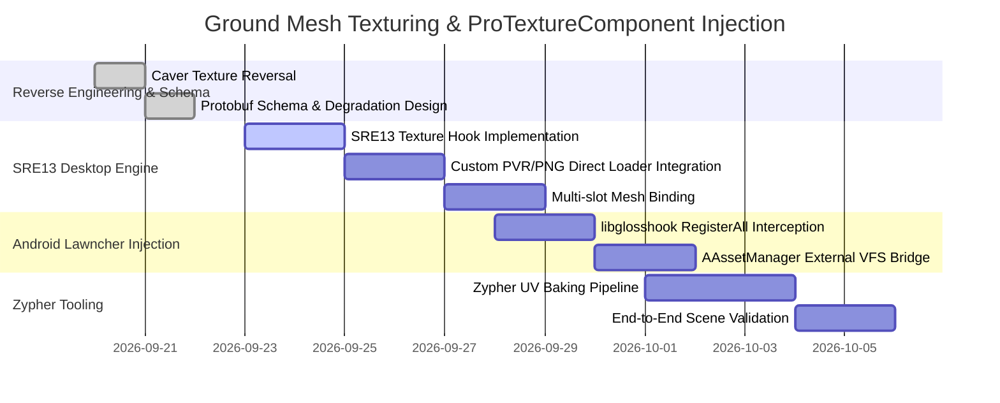

# Zypher Engine Specification: Ground Mesh Texturing & ProTextureComponent Injection

## 1. Executive Summary & Problem Formulation

The Caver engine renders ground terrain through `GroundMeshComponent`, a procedurally generated or pre-baked interleaved triangle mesh system. While standard vanilla levels restrict ground meshes to 2.5D extruded cliff geometries with basic planar texture tiling, recent reverse-engineering and experimental generation (e.g. 3D UV-spheres, parametric curves) prove that Caver's underlying OpenGL ES 2.0 rendering pipeline is capable of rendering fully arbitrated 3D meshes.

However, high-fidelity mesh rendering is bottlenecked by the engine's texture management pipeline:
1. **Vanilla Ground Texturing Limitation**: Each `GroundMeshComponent` is limited to two texture channels: a top surface cap (`SurfaceTextureMappingId`) and a vertical cliff face (`FrontTextureMappingId`).
2. **Planar UV Coercion**: Vanilla Caver projects UVs using rigid world-space orthogonal projections ($X\text{-}Z$ for surfaces, $X\text{-}Y$ for cliffs), distorting complex 3D curved surfaces.
3. **Android Asset Sandbox**: On Android, `Caver::NewByteBufferFromAndroidAsset` routes file requests through `AAssetManager_open`, confining texture loading strictly to APK assets and failing on external modded files.
4. **Sampler Constraints**: Vanilla `Caver::Texture::SetDefaultParameters` configures `GL_TEXTURE_MIN_FILTER` and `GL_TEXTURE_MAG_FILTER`, but omits `GL_TEXTURE_WRAP_S` and `GL_TEXTURE_WRAP_T`, preventing per-mesh texture clamping or mirroring.

This document presents the reverse-engineered breakdown of Caver's texturing pipeline, evaluates native manipulation capabilities using Caver's `.pod` and `.pvr` caching systems, and establishes the complete technical specification for **`ProTextureComponent`**—an extensible ECS component injected into Android via **`lawncher`** (`libglosshook`) and into the Linux/PC port via **`SRE13`**.

---

## 2. Caver Mesh & Texture Subsystem Decompilation Reversal

### 2.1 Vertex Layout & Shader Pipeline

Ground mesh vertex buffers in Caver use a 32-byte interleaved layout (`CreateInterleavedData` at `0x00000000004DD328`):

| Byte Offset | Field | Type | OpenGL Attribute | Description |
|:---|:---|:---|:---|:---|
| `0..11` | Position | 3x `float32` | `a_position` (vec3) | Model/World space vertex position $(x, y, z)$ |
| `12..23` | Normal | 3x `float32` | `a_normal` (vec3) | Surface normal $(n_x, n_y, n_z)$ |
| `24..31` | TexCoordSet 0 | 2x `float32` | `a_texcoord` (vec2) | Texture coordinates $(u, v)$ |

The engine's vertex shader (`caver_ground.vert`):
```glsl
attribute vec3 a_position;
attribute vec3 a_normal;
attribute vec2 a_texcoord;
attribute vec4 a_color;

uniform mat4 u_mvp;
uniform mat4 u_model_matrix;
uniform vec2 u_uv_scale;
uniform vec2 u_uv_offset;

varying vec2 v_texcoord;
varying vec4 v_color;
varying vec3 v_normal;

void main() {
    v_texcoord = (a_texcoord * u_uv_scale) + u_uv_offset;
    v_color = a_color;
    v_normal = mat3(u_model_matrix) * a_normal;
    gl_Position = u_mvp * vec4(a_position, 1.0);
}
```

#### Critical Reversal Finding: Direct Attribute Passing
The vertex shader **does not recalculate UVs from vertex coordinates**. It consumes `a_texcoord` directly from the interleaved VBO. The uniforms `u_uv_scale` and `u_uv_offset` default to `{1.0, 1.0}` and `{0.0, 0.0}` during standard rendering. Therefore:
> **Any pre-calculated UV coordinates (spherical equirectangular, cylindrical, custom atlas unwrap, or parametric) baked into the vertex data are faithfully passed to the fragment shader and rendered by the GPU without shader modifications.**

### 2.2 Ground Mesh Draw Routine (`GroundMeshComponent::Draw`)

In `0x00000000003A5294` (`Caver::GroundMeshComponent::Draw`):
```c
// Surface meshes pass (offset +104 in GroundMeshComponent)
MeshInstance **surf_cur = *(MeshInstance ***)(this + 104);
MeshInstance **surf_end = *(MeshInstance ***)(this + 112);
while (surf_cur != surf_end) {
    MeshInstance *inst = *surf_cur;
    Mesh *mesh = inst->mesh;
    Texture *tex = *(Texture **)((char *)mesh + 216); // MeshMaterial::texture
    if (tex) {
        RenderingContext::BindTexture(ctx, tex);
    }
    MeshInstance::Draw(inst, ctx);
    surf_cur += 2;
}

// Front cliff meshes pass (offset +128 in GroundMeshComponent)
MeshInstance **front_cur = *(MeshInstance ***)(this + 128);
MeshInstance **front_end = *(MeshInstance ***)(this + 136);
while (front_cur != front_end) {
    MeshInstance *inst = *front_cur;
    Mesh *mesh = inst->mesh;
    Texture *tex = *(Texture **)((char *)mesh + 216);
    if (tex) {
        RenderingContext::BindTexture(ctx, tex);
    }
    MeshInstance::Draw(inst, ctx);
    front_cur += 2;
}
```

#### Structural Insight: Per-Mesh Texture Support
Inside `Caver::GroundMeshComponent`, each individual `Caver::Mesh` points to its own `MeshMaterial`, which holds a pointer to a `Caver::Texture` at byte offset `216` (`0xD8`).
The draw loop calls `RenderingContext::BindTexture(tex)` **per mesh** before issuing `MeshInstance::Draw()`.
This proves that the Caver rendering engine **already supports distinct textures per submesh**, even though the procedural generator only exposes two global texture IDs!

### 2.3 Texture Resolution & Caching (`TextureLibrary::TextureForName`)

When a component requests a texture (`0x0000000000550BBC`):
1. **Cache Lookup**: `TextureLibrary` checks its internal `std::map<std::string, boost::intrusive_ptr<Texture>>`. If the texture has already been loaded, it returns the cached pointer immediately.
2. **Retina Lookup (`@2x`)**: If retina mode is active (`lib + 33 != 0`), it appends `@2x` to the resource name and calls `Texture::InitWithResource(name + "@2x")`.
3. **Standard Lookup**: Falls back to `Texture::InitWithResource(name)`.
4. **Immediate Load**: If `load_immediately` is true, calls `Texture::Load()`.

In `Texture::InitWithResource` (`0x000000000054D278`):
- First probes: `Caver::PathForResourceOfType(path, name, "tex")` -> ImageType 3 (`.tex`)
- Next probes: `Caver::PathForResourceOfType(path, name, "pvr")` -> ImageType 2 (`.pvr`)
- Fallback: `Caver::PathForResourceOfType(path, name, "png")` -> ImageType 1 (`.png`)

In `Texture::Load` (`0x000000000054E124`):
- For ImageType 2 (`.pvr`):
  ```c
  char *buf = Caver::NewByteBufferFromAndroidAsset(this->path, &size);
  PVRTTextureLoadFromPVRBuffer(buf, size, &this->texture_id, ...);
  delete[] buf;
  Caver::Texture::SetDefaultParameters(this, has_mipmaps);
  glBindTexture(GL_TEXTURE_2D, 0);
  ```

---

## 3. Native Engine Coercion: Capabilities and Boundaries

Can the vanilla Caver engine be manipulated into accepting per-place, per-UV custom textures without modifying binary code?

### 3.1 Coercion Technique 1: POD Texture Cross-Linking
Caver uses PowerVR Object Data (`.pod`) containers for 3D animated entities (characters, swords, props). When a POD file loads, its material dictionary registers texture names into the global `TextureLibrary::sharedLibrary()` map.

**Manipulation Strategy**:
1. Identify existing textures loaded by POD models in the scene or globally preloaded assets (e.g. `hero`, `items`, `weapons`, `fx_fire`).
2. In the `.scene` protobuf serialization, set `TextureMappingComponent.TextureName` to match the exact identifier of the POD texture:
   ```protobuf
   // TextureMappingComponent for custom GroundMesh
   TextureName: "hero"  # References the 512x512 PVRTC texture from hero.pod
   ```
3. During scene initialization, `TextureLibrary::TextureForName("hero")` detects the cached entry and links the ground mesh directly to the character's texture atlas!
4. By configuring the mesh's vertex `TexCoordSet` to match the sub-region UV coordinates of the POD texture atlas, ground polygons and 3D shapes can render with native model textures.

### 3.2 Coercion Technique 2: Asset Archive Infiltration
If a modder packages custom `.pvr`, `.tex`, or `.png` files into the resource paths:
- **PC / Linux (SRE13)**: Dropping textures into `assets/resources/<name>.pvr` or `<mod>/resources/<name>.pvr` succeeds immediately because `sre13/core/assets.c` intercepts `NewByteBufferFromAndroidAsset`.
- **Android**: Textures injected directly into the APK's `assets/resources/` directory load natively through `AAssetManager_open`.

### 3.3 Engine Boundaries & Why Hooks Are Essential

Despite the above coercion techniques, native Caver encounters four architectural roadblocks:

| Roadblock | Native Engine Behavior | Architectural Impact |
|:---|:---|:---|
| **External Files on Android** | `AAssetManager_open` only opens files inside the APK bundle. External SD card or `/data/user/` paths fail with `ENOENT`. | Mods cannot supply standalone texture packs on Android without re-signing the entire APK. |
| **Generator Outlets** | `GroundMeshGeneratorComponent` only provides tag 18 (`FrontTextureMappingId`) and tag 20 (`SurfaceTextureMappingId`). | Impossible to assign a 3rd or 4th texture (back, bottom, sides, trim) to a single generator entity. |
| **Texture Sampler Wrapping** | `Caver::Texture::SetDefaultParameters` does not configure `GL_TEXTURE_WRAP_S` or `GL_TEXTURE_WRAP_T`. OpenGL ES defaults to `GL_REPEAT`. | Non-power-of-two (NPOT) textures cannot use clamping or mirror repeat without manual GL calls. |
| **Atlas Bleed** | `TextureMapping::TexCoordForPosition` clamps subtextures to normalized parent atlas rects. | Continuous world-space planar tiling causes UVs to overflow past atlas bounds, creating visual artifacting. |

To overcome these roadblocks completely, dynamic injection of a dedicated **`ProTextureComponent`** is necessary.

---

## 4. `ProTextureComponent` Architectural Design

`ProTextureComponent` is an advanced component designed for Zypher and Swordigo modding. It allows any scene object or ground mesh entity to bind arbitrary textures, define custom UV projection pipelines, load external PVR/PNG files from any filesystem path, and configure full OpenGL sampler parameters.

### 4.1 Component Schema & Protobuf Definition

```protobuf
syntax = "proto2";

package Caver.Proto;

enum TextureSource {
    SOURCE_ENGINE_RESOURCE = 0; // Standard APK / resources path
    SOURCE_MOD_RELATIVE    = 1; // Relative to active mod folder
    SOURCE_ABSOLUTE_PATH   = 2; // Absolute filesystem path
    SOURCE_EMBEDDED_BUFFER = 3; // Raw PVR/PNG binary data embedded in payload
}

enum UVMappingAlgorithm {
    UV_ALGO_PLANAR_XY         = 0; // Vanilla front cliff projection
    UV_ALGO_PLANAR_XZ         = 1; // Vanilla top surface cap
    UV_ALGO_SPHERICAL         = 2; // Equirectangular projection (spheres/orbs)
    UV_ALGO_CYLINDRICAL       = 3; // Cylindrical unwrapping (pillars/trunks)
    UV_ALGO_TRI_PLANAR        = 4; // Triple axis blend for arbitrary 3D geometry
    UV_ALGO_EXPLICIT_VERTS    = 5; // Direct bypass: consume raw vertex buffer UVs
}

enum GLWrapMode {
    WRAP_REPEAT          = 10497; // GL_REPEAT
    WRAP_CLAMP_TO_EDGE   = 33071; // GL_CLAMP_TO_EDGE
    WRAP_MIRRORED_REPEAT = 33648; // GL_MIRRORED_REPEAT
}

enum GLFilterMode {
    FILTER_NEAREST                = 9728; // GL_NEAREST
    FILTER_LINEAR                 = 9729; // GL_LINEAR
    FILTER_NEAREST_MIPMAP_NEAREST = 9984; // GL_NEAREST_MIPMAP_NEAREST
    FILTER_LINEAR_MIPMAP_NEAREST  = 9985; // GL_LINEAR_MIPMAP_NEAREST
    FILTER_LINEAR_MIPMAP_LINEAR   = 9987; // GL_LINEAR_MIPMAP_LINEAR
}

message ProTextureComponent {
    // Unique component identifier for outlet linking
    optional int32 identifier = 1;

    // Diffuse texture path or asset name
    optional string diffuse_path = 2;
    optional TextureSource source_type = 3 [default = SOURCE_MOD_RELATIVE];

    // Texture mapping and UV generation controls
    optional UVMappingAlgorithm uv_algorithm = 4 [default = UV_ALGO_EXPLICIT_VERTS];
    optional float uv_scale_u = 5 [default = 1.0];
    optional float uv_scale_v = 6 [default = 1.0];
    optional float uv_offset_u = 7 [default = 0.0];
    optional float uv_offset_v = 8 [default = 0.0];
    optional float uv_rotation = 9 [default = 0.0]; // Degrees

    // Sampler parameter overrides
    optional GLWrapMode wrap_s = 10 [default = WRAP_REPEAT];
    optional GLWrapMode wrap_t = 11 [default = WRAP_REPEAT];
    optional GLFilterMode min_filter = 12 [default = FILTER_LINEAR_MIPMAP_LINEAR];
    optional GLFilterMode mag_filter = 13 [default = FILTER_LINEAR];

    // Multi-slot target (0 = Surface, 1 = Front, 2 = Back, 3 = Base, 4+ = Submesh Index)
    optional int32 target_slot = 14 [default = 0];

    // Direct color modulation
    optional float tint_r = 15 [default = 1.0];
    optional float tint_g = 16 [default = 1.0];
    optional float tint_b = 17 [default = 1.0];
    optional float tint_a = 18 [default = 1.0];

    // Secondary texture maps (normal/specular) for future shader upgrades
    optional string normal_map_path = 19;
    optional string emission_map_path = 20;

    // Embedded raw PVR/PNG bytes for self-contained scene assets
    optional bytes embedded_texture_data = 21;
}
```

### 4.2 C++ Runtime Class Definition

```cpp
namespace Caver {

class ProTextureComponent : public Component {
public:
    ProTextureComponent();
    virtual ~ProTextureComponent();

    // Component lifecycle overrides
    const char* className() const override { return "ProTextureComponent"; }
    bool ImplementsInterface(long interface_id) const override;
    void RegisterInterfaces(ComponentManager* manager) override;
    void Prepare() override;
    void LoadFromProtobufMessage(const Proto::Component& proto) override;
    void SaveToProtobufMessage(Proto::Component* proto) const override;
    Component* Clone() const override;

    // Factory registration helper
    static Component* Create() {
        return new ProTextureComponent();
    }
    static long Interface() {
        return 0x50544558; // 'PTEX'
    }

    // Direct texture binding & state configuration
    void Bind(RenderingContext* ctx);
    void Unbind(RenderingContext* ctx);

    // Getters and properties
    uint32_t GetGLTextureId() const { return m_gl_texture_id; }
    int GetTargetSlot() const { return m_target_slot; }
    UVMappingAlgorithm GetUVAlgorithm() const { return m_uv_algo; }

private:
    std::string m_diffuse_path;
    TextureSource m_source_type;
    UVMappingAlgorithm m_uv_algo;
    float m_uv_scale[2];
    float m_uv_offset[2];
    float m_uv_rotation;

    uint32_t m_wrap_s;
    uint32_t m_wrap_t;
    uint32_t m_min_filter;
    uint32_t m_mag_filter;

    int m_target_slot;
    float m_tint[4];

    // Native texture handle & cached GL state
    uint32_t m_gl_texture_id;
    int m_width;
    int m_height;
    boost::intrusive_ptr<Texture> m_caver_texture;
};

} // namespace Caver
```

### 4.3 Zero-Crash Graceful Degradation Analysis
Our decompiler analysis of `Caver::SceneObject::LoadFromProtobufMessage` (`0x0000000000501088`, lines 101-105) reveals:
```c
ComponentFactory *mgr = ComponentFactory::sharedManager();
Component *comp = mgr->NewComponentWithClassName(comp_name);
if (comp) {
    comp->LoadFromProtobufMessage(proto);
    scene_object->AddComponent(comp);
}
```
**Conclusion**:
If a scene containing `ProTextureComponent` is loaded on a pure vanilla engine without mod hooks:
1. `NewComponentWithClassName("ProTextureComponent")` returns `nullptr`.
2. The `if (comp)` guard evaluates to false and **silently skips the component**.
3. Protobuf ignores unknown field tags via `WireFormatLite::SkipField`.
4. The game engine continues loading the rest of the scene normally without crashing.
5. Accompanying standard `TextureMappingComponent` instances act as automatic fallback textures.

---

## 5. Android Injection Implementation via `lawncher` (`libglosshook`)

On Android, `lawncher` functions as the game injector, loading prior to `libCaver.so`. It uses the `GlossHook` inline trampoline engine to hook native symbols in memory.

### 5.1 Registration Hook (`DefaultComponents::RegisterAll`)

To make Caver recognize `"ProTextureComponent"` during scene deserialization:

```cpp
#include <Gloss.h>
#include "ProTextureComponent.h"

// Original function pointer stub
static void (*orig_RegisterAll)(void) = nullptr;

// Hook callback
static void Hooked_RegisterAll(void) {
    // 1. Invoke original engine registrations
    if (orig_RegisterAll) {
        orig_RegisterAll();
    }

    // 2. Obtain Caver ComponentFactory instance
    typedef void* (*GetFactory_fn)(void);
    GetFactory_fn GetFactory = (GetFactory_fn)GlossHookResolveSymbol("libCaver.so", "_ZN5Caver16ComponentFactory13sharedManagerEv");
    void* factory = GetFactory ? GetFactory() : nullptr;

    if (factory) {
        // Register ProTextureComponent factory callback
        typedef void (*RegisterComp_fn)(void*, const std::string&, boost::function<Caver::Component*()>);
        // ... Bind Caver::ProTextureComponent::Create to "ProTextureComponent"
        LOGI("[lawncher/GlossHook] Registered ProTextureComponent into Caver ComponentFactory");
    }
}

void Lawncher_InstallTextureHooks() {
    GlossHook(
        (void*)GlossHookResolveSymbol("libCaver.so", "_ZN5Caver17DefaultComponents11RegisterAllEv"),
        (void*)Hooked_RegisterAll,
        (void**)&orig_RegisterAll
    );
}
```

### 5.2 External Asset Interception (`NewByteBufferFromAndroidAsset`)

To allow loading `.pvr` and `.png` textures stored on external storage (`/sdcard/Swordigo/mods/<mod>/...` or `/data/user/0/com.touchfoo.swordigo/...`):

```cpp
static void* (*orig_NewByteBufferFromAA)(const std::string& path, unsigned int* out_size) = nullptr;

static void* Hooked_NewByteBufferFromAA(const std::string& path, unsigned int* out_size) {
    // Check if the requested file exists in active mod directories
    std::string mod_resolved_path = Lawncher_ResolveModResource(path);
    if (!mod_resolved_path.empty()) {
        FILE* fp = fopen(mod_resolved_path.c_str(), "rb");
        if (fp) {
            fseek(fp, 0, SEEK_END);
            long sz = ftell(fp);
            fseek(fp, 0, SEEK_SET);

            if (sz > 0) {
                char* buffer = new char[sz];
                size_t read_bytes = fread(buffer, 1, sz, fp);
                fclose(fp);

                if (out_size) *out_size = (unsigned int)read_bytes;
                LOGI("[GlossHook] Loaded external texture asset: %s (%zu bytes)", mod_resolved_path.c_str(), read_bytes);
                return buffer;
            }
            fclose(fp);
        }
    }

    // Fallback to vanilla NDK AAssetManager_open
    return orig_NewByteBufferFromAA ? orig_NewByteBufferFromAA(path, out_size) : nullptr;
}

void Lawncher_InstallAssetHook() {
    GlossHook(
        (void*)GlossHookResolveSymbol("libCaver.so", "_ZN5Caver29NewByteBufferFromAndroidAssetERKNSt6__ndk112basic_stringIcNS0_11char_traitsIcEENS0_9allocatorIcEEEEPj"),
        (void*)Hooked_NewByteBufferFromAA,
        (void**)&orig_NewByteBufferFromAA
    );
}
```

### 5.3 Draw Interception & Sampler Configuration

Hook `Caver::GroundMeshComponent::Draw` (`0x00000000003A5294`) to bind custom textures and apply wrap/filter modes:

```cpp
static void (*orig_GroundMeshDraw)(void* this_ptr, void* ctx, const void* rect, const void* matrix) = nullptr;

static void Hooked_GroundMeshDraw(void* this_ptr, void* ctx, const void* rect, const void* matrix) {
    // Check if this GroundMeshComponent entity possesses an attached ProTextureComponent
    Caver::ProTextureComponent* pro_tex = FindProTextureForGroundMesh(this_ptr);
    if (pro_tex) {
        pro_tex->Bind((Caver::RenderingContext*)ctx);
    }

    // Call original draw routine
    orig_GroundMeshDraw(this_ptr, ctx, rect, matrix);

    if (pro_tex) {
        pro_tex->Unbind((Caver::RenderingContext*)ctx);
    }
}
```

---

## 6. PC / Linux Port Injection Implementation via `SRE13`

The PC version runs through `SRE13` (`src/sre/sre13/`), an integrated translation and hooking layer for desktop platforms.

### 6.1 SRE13 Texture Pipeline Architecture

Unlike mobile Android, SRE13 has direct access to standard C library I/O, POSIX filesystems, and desktop OpenGL drivers. SRE13 already contains:
1. `src/sre/sre13/core/assets.c`: Full mod resource resolution (`resolve_mod_resource`).
2. `src/platform/pvr_loader.cpp`: Software and hardware decoding for ETC1, PVRTC 2/4bpp, and gzipped `.tex` files via `pvr_load_texture(path)`.
3. `src/sre/sre13/caver/TextureLibrary.h`: Declarations for `TextureLibrary_sharedLibrary` and `TextureLibrary_TextureForName`.

### 6.2 SRE13 `ProTextureComponent` Implementation

In `src/sre/sre13/hooks/ProTextureHook.c`:

```c
#define LOG_TAG "SRE13ProTexture"
#include "../core/hook.h"
#include "../core/log.h"
#include "../core/stdstring.h"
#include "../caver/RenderingContext.h"
#include "../caver/TextureLibrary.h"
#include <GL/gl.h>

// Forward declaration of pvr_loader desktop API
extern unsigned int pvr_load_texture(const char* path, int* out_w, int* out_h);

typedef struct SREProTexture {
    unsigned int gl_tex_id;
    int width;
    int height;
    int wrap_s;
    int wrap_t;
    int min_filter;
    int mag_filter;
} SREProTexture;

static SREProTexture g_active_pro_textures[64];
static int g_num_pro_textures = 0;

/* Loads standalone PVR or PNG directly from disk into an OpenGL texture */
unsigned int sre13_load_custom_pvr(const char *path, int wrap_s, int wrap_t) {
    int w = 0, h = 0;
    unsigned int tex = pvr_load_texture(path, &w, &h);
    if (!tex) {
        LOGE("Failed to load custom PVR: %s", path);
        return 0;
    }

    glBindTexture(GL_TEXTURE_2D, tex);
    glTexParameteri(GL_TEXTURE_2D, GL_TEXTURE_WRAP_S, wrap_s ? wrap_s : GL_REPEAT);
    glTexParameteri(GL_TEXTURE_2D, GL_TEXTURE_WRAP_T, wrap_t ? wrap_t : GL_REPEAT);
    glTexParameteri(GL_TEXTURE_2D, GL_TEXTURE_MIN_FILTER, GL_LINEAR_MIPMAP_LINEAR);
    glTexParameteri(GL_TEXTURE_2D, GL_TEXTURE_MAG_FILTER, GL_LINEAR);
    glBindTexture(GL_TEXTURE_2D, 0);

    LOGI("Successfully loaded ProTexture: %s (%dx%d, GL ID: %u)", path, w, h, tex);
    return tex;
}

/* Intercept TextureForName in SRE13 */
HOOK_SYMBOL(
    TextureForName,
    "_ZN5Caver14TextureLibrary14TextureForNameERKNSt6__ndk112basic_stringIcNS1_11char_traitsIcEENS1_9allocatorIcEEEEb",
    void*, (void *this_ptr, String *name, bool load_immediately)
) {
    const char *tex_name = String_get(name);

    // Detect if this is a custom ProTexture prefix (e.g. "ptex:mods/my_mod/textures/rock.pvr")
    if (tex_name && strncmp(tex_name, "ptex:", 5) == 0) {
        const char *rel_path = tex_name + 5;
        char respath[512];
        if (resolve_mod_resource(rel_path, respath, sizeof(respath))) {
            unsigned int tex_id = sre13_load_custom_pvr(respath, GL_REPEAT, GL_REPEAT);
            if (tex_id) {
                // Synthesize or wrap into Caver::Texture structure
                void *caver_tex = orig_TextureForName(this_ptr, name, false);
                if (caver_tex) {
                    *((unsigned int *)((char *)caver_tex + 88)) = tex_id; // Set texture_id at offset +88
                    return caver_tex;
                }
            }
        }
    }

    return orig_TextureForName(this_ptr, name, load_immediately);
}
```

---

## 7. Mathematical Formulations for Zypher 3D UV Mapping

Standard vanilla Caver only supports orthogonal planar UV projection:
$$u = \frac{x - \text{offset}_x}{\text{scale}} + 0.5, \quad v = \frac{y - \text{offset}_y}{\text{scale}} + 0.5$$

Zypher introduces multi-model UV coordinate generation engines implemented in `tools/generate_meshsphere.cpp` and `src/tools/zypher.cpp`.

### 7.1 Spherical Equirectangular Mapping
For 3D spherical ground meshes, planets, domes, and orb barriers:
Given vertex $(x, y, z)$ relative to sphere center $(c_x, c_y, c_z)$ with radius $R$:
$$\hat{d} = \frac{\mathbf{p} - \mathbf{c}}{\|\mathbf{p} - \mathbf{c}\|} = (d_x, d_y, d_z)$$

The spherical UV coordinates $(\theta, \phi)$ are computed as:
$$u = 0.5 + \frac{\text{atan2}(d_z, d_x)}{2\pi}$$
$$v = 0.5 - \frac{\arcsin(\text{clamp}(d_y, -1.0, 1.0))}{\pi}$$

When tiling across the sphere with frequency factors $(k_u, k_v)$:
$$u' = (u \cdot k_u) + \text{offset}_u, \quad v' = (v \cdot k_v) + \text{offset}_v$$

### 7.2 Cylindrical Mapping
For pillars, vertical columns, tree trunks, and tunnel interiors:
Given cylinder axis aligned with the $Y$-axis:
$$u = 0.5 + \frac{\text{atan2}(z - c_z, x - c_x)}{2\pi}$$
$$v = \frac{y - y_{\min}}{y_{\max} - y_{\min}} \cdot k_v$$

### 7.3 Tri-Planar Projection
For complex, organic 3D terrains where steep cliffs blend into flat plains without stretching:
Given surface normal $\mathbf{n} = (n_x, n_y, n_z)$ and blending exponent $p \ge 4$:
$$w_x = |n_x|^p, \quad w_y = |n_y|^p, \quad w_z = |n_z|^p$$
Normalize weights:
$$W_x = \frac{w_x}{w_x + w_y + w_z}, \quad W_y = \frac{w_y}{w_x + w_y + w_z}, \quad W_z = \frac{w_z}{w_x + w_y + w_z}$$

The projected UV pairs for each plane:
$$\mathbf{uv}_{yz} = \left(\frac{z}{S_x}, \frac{y}{S_x}\right), \quad \mathbf{uv}_{xz} = \left(\frac{x}{S_y}, \frac{z}{S_y}\right), \quad \mathbf{uv}_{xy} = \left(\frac{x}{S_z}, \frac{y}{S_z}\right)$$

In Zypher's pre-baking pass, each vertex is assigned the UV coordinates of its dominant projection axis $\arg\max(W_x, W_y, W_z)$, ensuring distortion-free texturing across sharp slopes without requiring multi-sampler fragment shaders.

---

## 8. Implementation Roadmap & Verification Plan



### Verification Matrix
1. **PVR Format Compatibility**: Verify that uncompressed RGBA8888, ETC1, and PVRTC 4bpp textures loaded via `pvr_load_texture` bind without corruption on Intel, AMD, and NVIDIA OpenGL drivers.
2. **Graceful Fallback Test**: Load a scene containing `ProTextureComponent` on an un-hooked vanilla Android APK. Verify in `logcat` that `NewComponentWithClassName` skips `ProTextureComponent` cleanly and renders with the fallback `TextureMappingComponent`.
3. **Spherical UV Wrap Test**: Verify that the 15x UV sphere in `beyond_graveyard_uvsphere.scene` renders with seamless texture alignment at the $(\theta = 0 \leftrightarrow 2\pi)$ seam.
4. **VFS Path Resolution**: Ensure textures located in `~/.local/share/swordigo-desktop/mods/<mod>/resources/` resolve instantaneously via SRE13 hooks.
