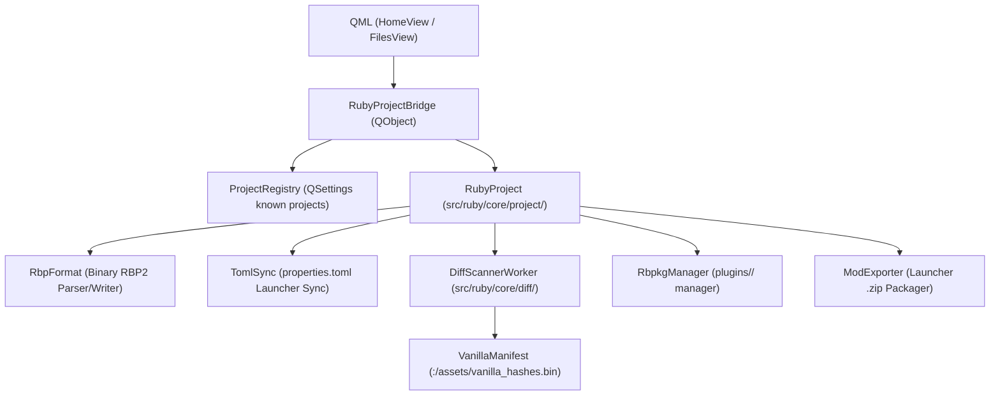

# Ruby Project & rbpkg Specification (v2.1)
*Authoritative Architecture for Ruby GG (Desktop Qt6) & Ruby Touch (Android)*

---

## 1. Executive Summary & Architectural Invariants

The **Ruby Project System** establishes a professional, git-friendly, and high-performance mod development environment for Swordigo. All coding agents and contributors must adhere to these strict invariants:

1. **Authoritative Working Directory (`project/`, NOT `resources/`)**:
   - The game assets being authored live strictly under `project/`.
   - The directory names `resources/` or `assets/` must **not** be used for project asset working trees.
2. **Skeleton Legacy Folders (`raw/` and `trans/`)**:
   - To support legacy FileRift Python tooling, empty `raw/` and `trans/` folders are generated upon project creation.
   - **Ruby completely ignores `raw/` and `trans/` after creation**: no file watching, no parsing, no VFS overlay, and no background synchronization. Modders managing raw markup handle those directories independently.
3. **Strict Separation: `properties.toml` vs `<name>.rbp`**:
   - `properties.toml` belongs exclusively to the external **Launcher** contract (partner team). Ruby must **never** write dev-time metadata, `rbpkg` dependencies, internal paths, or compiler flags into `properties.toml`. It remains lightweight (`id`, `name`, `author`, `version`, `description`).
   - All Ruby-specific configuration, `rbpkg` dependencies, target ABIs, session stats, and build options reside inside `<name>.rbp` (binary) and `.rbp/` cache files.
4. **Binary Project Descriptor (`.rbp`)**:
   - Proprietary binary TLV format with magic header `RBP2`.
   - File managers on Android and Desktop associate with `.rbp`. When opened via system Intent or file manager, **Ruby never opens `.rbp` in a text editor**; it intercepts the event, resolves the project root, and launches the Project Workspace.
5. **No Auto-Build — Dedicated Async Diff Engine**:
   - No continuous background recompilation or UI hitching.
   - Asset diffing against the vanilla baseline is performed on a background worker thread (`QThread`).
   - Uses stat cache (`mtime` + size) checks, falling back to xxHash64 calculation only when file stats change.
6. **Embedded Vanilla Hash Baseline**:
   - A pre-computed binary lookup table (`:/assets/vanilla_hashes.bin`, ~50 KB) is embedded in Ruby's resources.
   - Export diffing and "Revert to Vanilla" functions work out-of-the-box without requiring a clean extracted APK on disk.
7. **100% Backward Compatibility ("Loose Mode")**:
   - Opening a folder without a `.rbp` file operates in **Loose Mode** (existing behavior).

---

## 2. Standard Directory Layout

```text
RubyProjects/<project_name>/
├── <project_name>.rbp             # Binary Project Descriptor (Magic: 'R','B','P','2')
├── properties.toml                # Launcher mod manifest (ID, Name, Author, Version)
├── icon.png                       # Mod icon (PNG format, 128x128 / 256x256)
├── .gitignore                     # Auto-generated git ignore (.rbp/, builds/)
│
├── .rbp/                          # Ruby Project Metadata & Cache (Git-ignored / Hidden)
│   ├── diff_cache.bin             # Cached asset hashes & diff ledger against vanilla
│   └── logs/
│       ├── project.log            # Activity, load, and edit session logs
│       └── export.log             # Build and packaging logs
│
├── project/                       # THE ACTIVE ASSET FOLDER (CALLED project/, NOT resources/)
│   ├── hiro.POD                   # 3D models, textures, scenes, audio
│   ├── data/                      # Level scenes (.scene, .scl)
│   └── ...
│
├── plugins/                       # rbpkg Modder Libraries (Copied from Ruby Assets/Store)
│   ├── arm64-v8a/
│   │   ├── libluajitcli.so        # Runtime library
│   │   └── libswdbg.so            # Devtime library
│   └── armeabi-v7a/
│
├── raw/                           # SKELETON ONLY (Ignored by Ruby - for legacy modders)
├── trans/                         # SKELETON ONLY (Ignored by Ruby - for legacy modders)
│
└── builds/                        # Exported Launcher .zip archives
    └── v1.0.0/
        ├── <id>-v1.0.0.zip        # Ready for Launcher import
        └── build.json             # Build receipt & sha256 checksums
```

---

## 3. Byte-Level `.rbp` Binary Format Specification

The `<name>.rbp` file uses a Tag-Length-Value (TLV) chunked binary format.

### General Serialization Rules:
- **Endianness**: Little-Endian (LE) across all multi-byte fields (`uint16_t`, `uint32_t`, `uint64_t`).
- **Strings**: Prefix of `uint16_t` byte length followed by raw UTF-8 bytes (no null terminator).
- **Forward Compatibility**: Unknown chunk FourCC codes must be skipped by seeking forward `chunk_length` bytes.

### 3.1 Header (16 Bytes):
| Offset | Type | Field | Description |
| :--- | :--- | :--- | :--- |
| `0x00` | `char[4]` | `magic` | `'R', 'B', 'P', '2'` (`0x52425032`) |
| `0x04` | `uint32_t` | `format_version` | `2` (LE) |
| `0x08` | `uint32_t` | `header_size` | `16` (LE) |
| `0x0C` | `uint32_t` | `chunk_count` | Number of data chunks in file |

### 3.2 Chunk Envelope (8 Bytes):
| Offset | Type | Field | Description |
| :--- | :--- | :--- | :--- |
| `+0x00` | `char[4]` | `chunk_type` | FourCC identifier (`META`, `PKGS`, `STAT`) |
| `+0x04` | `uint32_t` | `chunk_length` | Payload length in bytes (excluding envelope) |
| `+0x08` | `uint8_t[]` | `payload` | Byte array of length `chunk_length` |

### 3.3 Chunk Definitions:

#### A. Chunk `META` (`0x4D455441`) — Project Metadata
| Type | Field | Description |
| :--- | :--- | :--- |
| `uint16_t + UTF-8` | `id` | Mod unique package identifier (`net.aevora.mod.crystal`) |
| `uint16_t + UTF-8` | `name` | Project display name (`Crystal Caverns`) |
| `uint16_t + UTF-8` | `author` | Mod author name |
| `uint16_t + UTF-8` | `version` | Semantic version string (`1.0.0`) |
| `uint16_t + UTF-8` | `description` | Mod overview description |
| `uint64_t` | `created_ts` | Unix timestamp of creation |
| `uint64_t` | `last_modified_ts` | Unix timestamp of last edit |
| `uint16_t` | `target_abis` | Bitfield: `1 = arm64-v8a`, `2 = armeabi-v7a`, `4 = x86_64` |
| `uint8_t` | `compiler_pipeline`| `0 = FileRift v2 (Default)`, `1 = Protoc Binary`, `2 = Raw Passthrough` |

#### B. Chunk `PKGS` (`0x504B4753`) — rbpkg Dependencies
| Type | Field | Description |
| :--- | :--- | :--- |
| `uint16_t` | `entry_count` | Number of installed rbpkg packages |
| Repeated entries: | | |
| `uint16_t + UTF-8` | `package_id` | Package name (`luajit-cli`, `swdbg`) |
| `uint16_t + UTF-8` | `package_ver` | Package version string (`2.1.0`) |
| `uint8_t` | `flags` | Bit 0: `0 = Runtime library`, `1 = Devtime library` |

#### C. Chunk `STAT` (`0x53544154`) — Session & Project Statistics
| Type | Field | Description |
| :--- | :--- | :--- |
| `uint32_t` | `edit_count` | Total cumulative edit/save operations |
| `uint32_t` | `scene_count` | Number of `.scene` levels discovered |
| `uint16_t + UTF-8` | `last_opened_scene` | Relative path to last edited scene |

---

## 4. Binary `.rbp/diff_cache.bin` Specification

To prevent redundancy, all package installation state and asset diff ledgers are unified in `.rbp/diff_cache.bin`.

### Header (24 Bytes):
| Offset | Type | Field | Description |
| :--- | :--- | :--- | :--- |
| `0x00` | `char[4]` | `magic` | `'D', 'C', 'A', 'C'` (`0x44434143`) |
| `0x04` | `uint32_t` | `format_version` | `1` (LE) |
| `0x08` | `uint64_t` | `vanilla_base_hash` | xxHash64 of the vanilla manifest used for baseline |
| `0x10` | `uint32_t` | `entry_count` | Number of tracked asset records |
| `0x14` | `uint32_t` | `reserved` | `0` |

### Entry Record:
| Type | Field | Description |
| :--- | :--- | :--- |
| `uint16_t + UTF-8` | `rel_path` | Relative path inside `project/` (e.g. `data/Level1.scene`) |
| `uint64_t` | `mtime` | Cached filesystem modification time (`st_mtime`) |
| `uint64_t` | `file_size` | Cached byte size |
| `uint64_t` | `xxhash64` | Fast xxHash64 of file content |
| `uint8_t` | `status` | `0 = Unchanged`, `1 = Modified`, `2 = New` |

---

## 5. Vanilla Baseline Architecture & Embedded Manifest

- **Pre-computed Manifest**: Embedded in Qt resources at `:/assets/vanilla_hashes.bin` (~50 KB). Contains the relative paths, expected file sizes, and pre-computed xxHash64 hashes of all 1,200+ vanilla Swordigo assets.
- **Export Diffing**: When preparing export packages, Ruby evaluates files in `project/`:
  - If a file exists in the vanilla manifest with identical xxHash64 $\to$ **Unchanged** (excluded from `.zip`).
  - If a file exists in the vanilla manifest with different xxHash64 $\to$ **Modified** (included in `.zip`).
  - If a file does not exist in the vanilla manifest $\to$ **New** (included in `.zip`).
- **No APK Extraction Prerequisite**: Modders do not need an extracted clean APK on disk to diff or package mods.

---

## 6. High-Risk Edge Cases & Engine Safeguards

### 6.1 Cross-Device `mtime` & Clock Skew Healing (USB/ADB/Git)
- **The Problem**: Transferring a project via USB MTP, ADB, or Zip archive touches every file's `mtime` to the current system time, which invalidates stat cache checks.
- **The Engine Rule**: When `mtime` or `file_size` differs from `diff_cache.bin`, the Diff Engine computes xxHash64:
  - If the hash matches the cached hash (or vanilla baseline), **it is not dirty**.
  - The engine silently updates `mtime` in `diff_cache.bin` to the new timestamp and preserves `status = Unchanged`.

### 6.2 Write-Lock Awareness (`hiro.POD` Protection)
- **The Problem**: A background thread running every 10–15 seconds could read `hiro.POD` while Ruby's main thread is halfway through saving it, resulting in corrupted cache hashes.
- **The Engine Rule**: The active editor registers write locks (`EditorWriteLock`). The `DiffScannerWorker` skips any file currently marked locked until saving finishes.

### 6.3 Case-Sensitivity Validator
- **The Problem**: Windows is case-insensitive (`Data/Level.scene` vs `data/level.scene`). Android (ext4/f2fs) will fail to mount overlays if casing differs from vanilla.
- **The Engine Rule**: The background scanner checks relative paths against `vanilla_hashes.bin`. If the casing differs, it logs a warning in `.rbp/logs/project.log` and surfaces a non-blocking warning badge in UI: *"Warning: Path casing differs from vanilla asset."*

### 6.4 Vanilla File Deletion Warning
- **The Problem**: Launcher overlays mod assets over vanilla. Deleting a file in `project/` cannot remove it from the vanilla APK.
- **The Engine Rule**: When a user deletes a vanilla file, Ruby displays a toast:
  > *"Note: Deleting a vanilla game file will cause the Launcher to load the original unmodified file at runtime."*

### 6.5 Android 11+ `FileProvider` Sharing
- When triggering Launcher auto-import on Android, Ruby Touch uses `androidx.core.content.FileProvider`:
  ```java
  Uri contentUri = FileProvider.getUriForFile(context, "net.kiwi.rubytouch.fileprovider", zipFile);
  intent.setDataAndType(contentUri, "application/zip");
  intent.addFlags(Intent.FLAG_GRANT_READ_URI_PERMISSION);
  ```
  Raw `file://` URIs across app boundaries are strictly forbidden (`FileUriExposedException`).

---

## 7. Two-Tier Safety System for Reversion & Deletion

### Tier 1: Single-File Revert to Vanilla
- Accessed only via **hold / right-click on an individual modified file** in the file explorer.
- Action: Restores the pristine file from Ruby's embedded asset seed, recalculates its hash, and clears its modified flag in `diff_cache.bin`.
- Not permitted on entire folders.

### Tier 2: Destructive Project Actions (`"Ruby Delete"` Lock)
- Total Project Revert (wiping all changes in `project/`) and Project Deletion from disk are guarded by a strict confirmation modal.
- The action button is locked until the user types the exact string:
  ```text
  Ruby Delete
  ```
- Case-sensitive (Capital `R`, space, Capital `D`). If the string does not match, Ruby aborts without touching any files.

---

## 8. Launcher Export Pipeline

Launcher expects:
```text
<mod_id>.zip
├── properties.toml                # Pure launcher manifest
├── icon.png                       # Mod icon
├── libraries/                     # Runtime plugins mapped from plugins/
│   ├── arm64-v8a/
│   │   └── libluajitcli.so
│   └── armeabi-v7a/
└── <diffed game assets>           # Only New & Modified files from project/
    ├── data/
    │   └── Level_Grasslands.scene
    └── hiro.POD
```

### Pre-Export Sanity Checklist:
1. `id` matches reverse-domain regex (`^[a-z0-9_]+(\.[a-z0-9_]+)+$`).
2. `icon.png` exists and has valid PNG magic bytes (`0x89 0x50 0x4E 0x47`).
3. No zero-byte `.scene` or `.so` files exist in the export queue.
4. If an `arm64-v8a` runtime library is included, verify if `armeabi-v7a` is missing and warn if the project targets both ABIs.

---

## 9. Implementation Phases & Class Architecture



### Phase 1: Core Serialization (`src/ruby/core/project/`)
- `rbp_format.h / .cpp`:
  - `read_rbp()`, `write_rbp()` using atomic `.tmp` swap.
  - TLV chunk parsing (`META`, `PKGS`, `STAT`).
- `toml_sync.h / .cpp`:
  - Reads and writes strictly Launcher-compatible keys in `properties.toml`.

### Phase 2: Project Management & Registry (`src/ruby/core/project/`)
- `ruby_project.h / .cpp`:
  - Manages active project lifecycle, paths, `.rbp/logs/project.log`.
  - Distinguishes Loose Mode vs Project Mode.
  - Provides `create_project()` skeleton scaffolding (including `.gitignore`).
- `project_registry.h / .cpp`:
  - Manages recent projects list in `QSettings`.
  - Path healing on folder rename/move.
  - Relative path formatting: `[ProjectName] /data/Level1.scene`.

### Phase 3: Background Diff Engine (`src/ruby/core/diff/`)
- `vanilla_manifest.h / .cpp`:
  - Parses embedded `:/assets/vanilla_hashes.bin`.
- `diff_scanner_worker.h / .cpp`:
  - `QThread` scanning `project/`.
  - Two-tier `stat` $\to$ xxHash64 check.
  - Emits `scanProgress(int percent)` and `scanCompleted()`.
  - Serializes to `.rbp/diff_cache.bin`.

### Phase 4: `rbpkg` & Export Engine (`src/ruby/core/export/`)
- `rbpkg_manager.h / .cpp`:
  - Copies `.so` from Ruby assets to `plugins/<abi>/`.
  - Classifies Runtime vs Devtime.
- `mod_exporter.h / .cpp`:
  - Packages diffed assets + `libraries/<abi>/` + `properties.toml` into `.zip`.
  - Writes `build.json` receipt.
  - Triggers Android Intent / Desktop file open.
